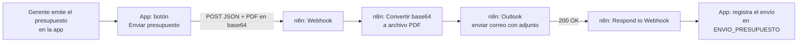

# 05 — Automatización con n8n: envío del presupuesto al cliente

## 1. Qué se automatiza y por qué
En el proceso As-Is, el dueño arma el presupuesto en Excel, lo exporta a PDF y lo envía a mano por correo. En el proceso To-Be, cuando un presupuesto queda **Emitido**, la aplicación lo entrega a **n8n**, que lo envía automáticamente al cliente desde el correo corporativo (Outlook), con el PDF adjunto. El resultado de cada envío queda registrado en la base de datos.

**Tarea del BPMN to-be automatizada:** «Enviar presupuesto al cliente», en el carril del sistema, después de «Emitir presupuesto». Ver [`02-bpmn.md`](./02-bpmn.md) y [`assets/BPMN TO-BE.png`](../assets/BPMN%20TO-BE.png).

> (Completar: verificar que el nombre de la tarea calce exactamente con el del diagrama BPMN to-be final.)

## 2. Flujo completo



## 3. Lado de la aplicación (`app/app.py`)
1. Solo un presupuesto en estado **Emitido** se puede enviar. La app lo valida antes de enviar.
2. En la pestaña «Flujo, PDF y envío», el usuario confirma el correo del cliente y presiona **Enviar presupuesto**.
3. La app genera el PDF y hace un `POST` al webhook de n8n con este contenido:

| Campo | Contenido |
|---|---|
| `evento` | `"presupuesto_emitido"` |
| `id_presupuesto`, `nombre_proyecto` | Identificación del presupuesto |
| `cliente` | `rut` y `razon_social` |
| `email_destino` | Correo del cliente |
| `asunto`, `cuerpo` | Texto del correo, ya redactado |
| `fecha_emision`, `valor_uf_dia` | Datos del presupuesto |
| `totales` | Costo directo, GG, utilidad, total neto, IVA y totales en UF |
| `partidas`, `externos` | Detalle del presupuesto |
| `pdf` | `nombre_archivo`, `mime` y `base64` (el PDF codificado) |

4. La app espera la respuesta hasta 25 segundos. Si n8n responde con un código 2xx, el envío se registra como **Enviado**; si responde con error o no responde, como **Error**, con el detalle. El registro queda en la tabla `ENVIO_PRESUPUESTO` (fecha, correo, canal, resultado y detalle) y se ve en el historial de envíos de la app.

La URL del webhook se configura en `app/.streamlit/secrets.toml`:
```toml
[n8n]
webhook_url = "https://SU-INSTANCIA.app.n8n.cloud/webhook/presupuesto-emitido"
```

## 4. Lado de n8n: nodos del flujo
El flujo exportado está en [`n8n/flujo-envio-presupuesto.json`](../n8n/flujo-envio-presupuesto.json) y se puede importar en n8n con *Import from File*.

| # | Nodo | Configuración |
|---|---|---|
| 1 | **Webhook** | Método `POST`, ruta `presupuesto-emitido`. *Respond:* «Using 'Respond to Webhook' Node» (responder al final, no al recibir). |
| 2 | **Convert to File** | Operación «Move Base64 String to File». Origen: `body.pdf.base64`. Nombre del archivo: `{{ $json.body.pdf.nombre_archivo }}`. Tipo: `application/pdf`. |
| 3 | **Microsoft Outlook** | *Message → Send*. Para: `{{ $('Webhook').item.json.body.email_destino }}`. Asunto: `{{ $('Webhook').item.json.body.asunto }}`. Cuerpo: `{{ $('Webhook').item.json.body.cuerpo }}`. Adjunto: la propiedad binaria del nodo anterior (`data`). Credencial: cuenta corporativa de Outlook. |
| 4 | **Respond to Webhook** | Código `200`, respuesta `{"ok": true}`. |

**Por qué se responde al final:** la app registra «Enviado» cuando recibe la respuesta 2xx. Si n8n respondiera apenas recibe el webhook, un correo que después falló quedaría registrado como enviado.

**Errores (recomendado):** en el nodo de Outlook, activar *On Error → Continue (using error output)* y conectar esa salida a otro «Respond to Webhook» con código `500`. Así, si Outlook falla, la app registra «Error».

> ( Completar: capturas del flujo armado en n8n y de la configuración de cada nodo, guardadas en `assets/`)

## 5. Puesta en marcha
1. Importar `n8n/flujo-envio-presupuesto.json` en n8n.
2. Conectar la credencial de Microsoft Outlook en el nodo de envío.
3. **Activar** el flujo y copiar la URL de **producción** del webhook (termina en `/webhook/...`, no en `/webhook-test/...`).
4. Pegar esa URL en `webhook_url` de `app/.streamlit/secrets.toml`.
5. En la app, emitir un presupuesto y presionar **Enviar presupuesto**.

## 6. Prueba realizada
> (Completar con la prueba real: fecha, presupuesto enviado, correo de destino (uno de prueba del equipo, no de un cliente real), captura del correo recibido con el PDF adjunto y captura del historial de envíos de la app con resultado «Enviado».)

## 7. Beneficio para la PYME
- El presupuesto llega al cliente apenas se emite, sin pasos manuales de exportar, adjuntar y redactar.
- El correo y el PDF siempre salen con el mismo formato y los totales calculados por el sistema.
- Cada envío queda registrado (cuándo, a quién y si llegó), lo que da trazabilidad que el proceso manual no tenía.
